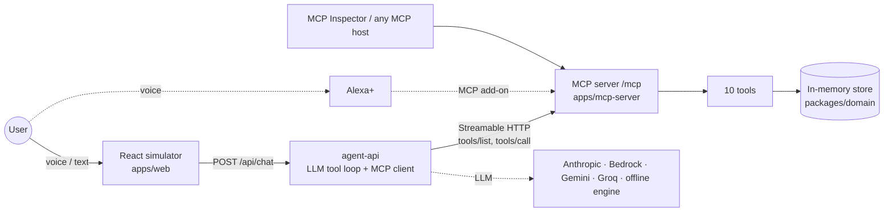

# Parcel Concierge for Alexa+

**Parcel tracking, customs help and delivery changes by voice, built as a self-hosted MCP server for Alexa+.**
Built for the Amazon Developer "Build, Ship, Shape" Hackathon 2026, Alexa+ track.

> All data is **fictional**. "SwiftLane Express", the customer "Alex Rivera", the parcels and the tracking numbers are mock data, and no real carrier API is called. The web app is a **simulated** Alexa+ experience: it isn't Amazon's product and it doesn't use Amazon branding.

## The problem

Parcels get stuck in customs and deliveries get missed. Carrier tracking pages are confusing, especially for customs, where hold codes, HS codes and duty sums mean little to most people. Fixing a problem usually takes several web forms.

## The solution

Parcel Concierge exposes a carrier's parcel and customs operations as **MCP tools**. A voice assistant like Alexa+ can then answer "Why is my phone stuck in customs?", read back the duty and pay it after you say yes, reschedule a delivery, leave a parcel with a neighbour, fix an address, or book a return, all in plain spoken sentences.

- **MCP server** (`apps/mcp-server`):
  - **protocol `2025-11-25`** over **Streamable HTTP** at `/mcp`, stateless
  - 10 tools with Zod schemas and annotations
  - each tool returns a **spoken-friendly** sentence plus `structuredContent` for cards
- **Simulated Alexa+ app** (`apps/web` + `apps/agent-api`):
  - an Echo-Show-style React UI with voice in and out
  - its agent is an **MCP client** of the same server, using an LLM or the built-in offline engine
  - a tool-trace panel shows every real MCP call

## Architecture



| Package | What it does |
|---|---|
| `packages/domain` | Zod schemas, seed data (dates relative to now), in-memory store, pure business rules, and one service method per tool returning `{ speech, data }`. No HTTP. |
| `apps/mcp-server` | Express 5 + `@modelcontextprotocol/sdk` `McpServer`, stateless Streamable HTTP at `/mcp`, `/healthz`, call log (`pino` + `/debug/calls`), `/debug/reset` |
| `apps/agent-api` | Express 5 backend for the web app: MCP `Client` over Streamable HTTP, a provider-neutral tool loop (max 6 rounds), cards from `structuredContent`, sessions, `/api/chat`, `/api/reset`, `/api/health` |
| `apps/web` | React 19 + Vite 8 + Tailwind 4 simulator: light bar, push-to-talk mic (Space), speech synthesis, text fallback, quick chips, 8 card types, tool-trace panel, Reset demo |

## Tools

| Tool | Kind | What it does |
|---|---|---|
| `list_active_shipments` | read | Parcels on the way, soonest first, and anything needing action |
| `track_shipment` | read | Status, ETA and window, last 5 events, instructions |
| `get_customs_status` | read | Plain-English hold reasons, missing documents, HS code, duty breakdown, next step |
| `pay_customs_duty` | write | **Two-step:** `confirm=false` quotes the amount; `confirm=true` pays (simulated, payment method on file). Never asks for card details. |
| `upload_customs_document` | write | Marks the commercial invoice or ID as received; releases the parcel if nothing else blocks it |
| `get_delivery_slots` | read | Up to 9 free slots (morning 8–12, afternoon 12–4, evening 4–8) |
| `reschedule_delivery` | write | Moves delivery to a free slot (not for delivered, unshipped or customs-held parcels) |
| `update_delivery_instructions` | write | Front or back door, neighbour ("Sam in 4B"), reception, gate code, or address correction, which fixes a failed delivery |
| `get_proof_of_delivery` | read | Delivery time, where it was left, photo reference |
| `request_return_pickup` | write | Books a pickup inside the return window; a QR code is emailed (simulated) |

Users name parcels by nickname ("my phone", "the coffee machine delivery") or tracking number. Unknown names return a helpful error that lists the real parcels. Ambiguous names ask which one was meant.

## Run locally

Requirements: **Node.js 22.9+** and npm. Tested on Node 25.9, Windows 10.

```bash
npm install
```

```bash
npm run dev
```

This starts four processes:
- the domain package compiler in watch mode
- the MCP server on **http://localhost:5100/mcp**
- the agent API on **http://localhost:5200**
- the web app on **http://localhost:5173** (open this one)

With no LLM key, the agent uses the **offline engine**, which handles every demo phrase below.

**Production build** (the agent API serves the built web app):

```bash
npm run build
```

```bash
npm start
```

**Checks:**

```bash
npm test
```

```bash
npm run typecheck
```

```bash
npm run lint
```

**Inspect the MCP server** with the official Inspector. Choose Streamable HTTP and enter `http://localhost:5100/mcp`:

```bash
npx @modelcontextprotocol/inspector
```

### Environment

Copy `.env.example` to `.env` in the repo root. Everything is optional for local runs.

| Variable | Used by | Purpose |
|---|---|---|
| `LLM_PROVIDER` | agent-api | `anthropic`, `bedrock`, `gemini`, `groq`, `openrouter`, `ollama`, `openai-compatible` or `offline`. Empty means Anthropic if a key is set, otherwise offline. |
| `ANTHROPIC_API_KEY`, `ANTHROPIC_MODEL` | agent-api | Anthropic Messages API (default model `claude-opus-5-5`) |
| `AWS_REGION`, `BEDROCK_MODEL_ID` (+ AWS credentials) | agent-api | Amazon Bedrock Converse API |
| `LLM_API_KEY`, `LLM_MODEL`, `LLM_BASE_URL` | agent-api | Free OpenAI-compatible providers (Gemini, Groq, OpenRouter, Ollama) |
| `MCP_SERVER_URL`, `MCP_DEV_TOKEN` | agent-api | Where the MCP server is, and an optional bearer token |
| `MCP_ALLOWED_HOSTS` | mcp-server | Public hostnames allowed on `/mcp` when deployed |
| `PORT` | both | Port for hosted deployments (App Runner and others set this) |

## Demo phrases

1. "Where are my packages?"
2. "Why is my phone stuck in customs?"
3. "Okay, pay the duty." It reads back $34.48, then you say "Yes".
4. "I sent the invoice — mark it uploaded." The phone is released.
5. "I won't be home tomorrow, can the books come Saturday evening?" It checks slots, then reschedules.
6. "Leave my running shoes with Sam next door."
7. "The coffee machine delivery failed — my unit is 12B."
8. "Was my headphones parcel delivered? I want to return them." It shows proof of delivery, asks the reason, then books the return.

## Deploy

Container images (Node 22 Alpine, multi-stage):

```bash
docker build -f deploy/Dockerfile.mcp -t parcel-mcp .
```

```bash
docker build -f deploy/Dockerfile.app -t parcel-app .
```

Push both to Amazon ECR and create two **AWS App Runner** services, or use Render or Railway.

1. For the MCP service, set `MCP_ALLOWED_HOSTS=<its public hostname>`. It listens on `PORT` (8080).
2. For the app service, set `MCP_SERVER_URL=https://<mcp-host>/mcp` and an LLM provider.

Alexa+ requires a public **HTTPS** URL for the MCP server.

### Alexa+ add-on (needs Alexa+ builder access)

Following the Alexa+ MCP QuickStart, these commands are not yet verified:

```bash
alexa-ai configure
```

```bash
alexa-ai new mcp --name "Parcel Concierge" --locale en-US --mcp-server-url "https://<host>/mcp"
```

```bash
alexa-ai deploy
```

Use the demo phrases above as example phrases. Redeploy after changing tools.

## Testing

`npm test` runs 40 Vitest tests:
- **domain (21):** nickname resolution and disambiguation, duty arithmetic, no payment without `confirm=true`, release rules, slot validation, address correction, return windows, relative-date seed, deterministic slots
- **MCP server (7):** a real SDK client over Streamable HTTP. It checks the `2025-11-25` negotiation, all 10 tools with schemas and annotations, spoken text plus `structuredContent` from every tool, two-step payment, helpful errors, 405 for GET/DELETE, and the call log and reset.
- **agent (12):** all 8 demo utterances end to end through the offline engine and the real MCP server, the scripted-LLM tool loop, fallback when the LLM fails, and the HTTP API

All 8 demo utterances were also run by hand in the web UI. See `NOTES.md` for what was and wasn't verified.

## Limitations

- Mock data only. The store is in memory and resets on restart or with "Reset demo".
- Payments, document uploads, photos and emails are simulated.
- The offline engine understands the demo phrases and close variants only. Use an LLM provider for free-form speech.
- No OAuth yet (P1). Don't expose `/mcp` publicly with real data.
- Voice input needs Chrome or Edge. Typing works everywhere.

## License

MIT. See [LICENSE](LICENSE).
